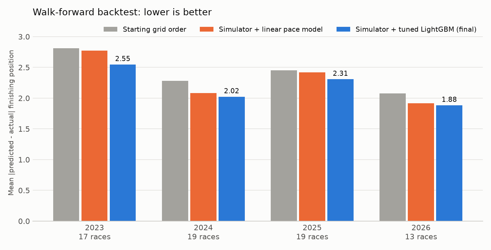
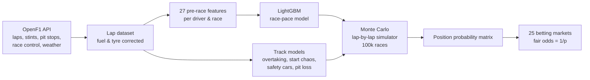

# F1 Race Predictor

Probabilistic forecasts for Formula 1 Grands Prix: a machine-learning model estimates each driver's race pace, and a lap-by-lap Monte Carlo simulator turns that pace into finishing-position probabilities and fair betting odds.

It is built entirely on open timing data from [OpenF1](https://openf1.org) and validated with a walk-forward backtest on **68 races (2023–2026)**.



## Results

Every prediction in the backtest uses only information that was available before that race started. Models are retrained race by race on past data only.

| Model | Mean position error | Winner log-loss | Winners called |
|---|---|---|---|
| Starting grid order (baseline) | 2.42 | – | – |
| Simulator + linear pace model | 2.32 | 1.39 | 40 / 68 |
| Simulator + Lasso (27 features) | 2.21 | 1.36 | 33 / 68 |
| **Simulator + tuned LightGBM (final)** | **2.21** | **1.13** | **39 / 68** |

- **Position error** is the mean absolute gap between predicted and actual finishing position, over classified drivers.
- **Winner log-loss** is the negative log of the probability the model gave to the actual winner. It is the metric that matters for pricing odds.

The final model beats the grid baseline in every season. Against the Lasso it matches positional accuracy and gives the actual winner much better-calibrated probabilities.

Example, 2026 United States GP (Austin, round 18): the model made Antonelli the favourite at 53% and he won. All 10 drivers it predicted in the points scored, and 2 of the 3 predicted podium finishers made the podium.

## How it works



### 1. Race pace from lap data
For every driver and race weekend, a robust regression on the clean laps strips out fuel load, tyre compound and tyre age, leaving a single "true" race pace. The same model applied to long runs in free practice and sprints gives pre-race pace estimates. Pit laps, safety-car laps, in/out laps and traffic outliers are excluded.

### 2. Feature table
For each driver and race the pipeline builds 27 candidate features, using only information available before the start:
- qualifying gap and position, grid penalties;
- per-session practice pace and best practice lap;
- driver and team form over the last three races;
- teammate deltas, reliability rates;
- track overtaking difficulty and safety-car rate;
- degradation, and rain earlier in the weekend.

### 3. Pace model
Pace models are compared with walk-forward cross-validation:
- a linear model on qualifying only;
- a hand-built linear model;
- a Lasso;
- LightGBM;
- a small neural network.

LightGBM is trained on all past seasons, with the current season's races weighted ×3 because the 2026 regulation change reset the competitive order.

Hyperparameters were tuned by random search. Settings were selected on 2023–25 plus early 2026, and the second half of 2026 was held out for verification. On the held-out races the error dropped 7%.

Permutation importance shows the signal comes from five features:
- recent team race pace;
- qualifying gap;
- qualifying position;
- best practice lap;
- recent driver race pace.

FP1, FP3, sprint results and weather add nothing.

### 4. Monte Carlo race simulator
Each simulated race runs lap by lap for 22 cars:
- **Pace**: predicted pace plus model uncertainty, with the scale calibrated on the backtest, and lap-to-lap noise.
- **Start**: lap-1 position shuffle calibrated per track, smaller at the front than in the midfield, adjusted for each driver's start form.
- **Overtaking**: a car within 1 s passes with probability `sigmoid(a_track + b × pace_advantage)`. The track difficulty comes from about 14k close battles from 2023–2026, and the 2026 level and slope are re-estimated from 2026 races.
- **Strategy**: one- or two-stop strategies with track-specific pit-loss times.
- **Randomness**: DNFs, and Poisson-distributed safety cars that bunch the field.

Team-mates finish in the same simulated race, so team markets ("both cars in the points") account for their correlation instead of multiplying independent probabilities.

### 5. Markets
From 100,000 simulated races [markets.py](markets.py) prices 25 markets with fair odds (1/p, no bookmaker margin):
- winner, podium and points;
- exact positions;
- head-to-heads;
- forecasts and tricasts;
- fastest lap;
- first retirement;
- constructor markets.

## Engineering notes

- **Leakage control**: every feature is computed with data up to the previous race only, and the backtest retrains the model before each race.
- **Data quality**: the backtest exposed gaps in the source data. Qualifying laps are missing for Baku 2025, and pit-lane times are missing for early 2023; both are handled with documented fallbacks instead of silently producing NaN rankings.
- **Reproducibility**: API responses are cached on disk and simulations use fixed random seeds, so model comparisons are run on identical random draws.

## Usage

```bash
python -m venv .venv && source .venv/bin/activate
pip install -r requirements.txt

python data.py && python laps.py && python features.py   # download & build 2026 data
python racesim.py 19 --sims 100000                       # simulate round 19
python markets.py 19                                     # betting markets -> data/mercati_r19_*.xlsx
```

To train on historical seasons, build their data first:

```bash
cd seasons/2025 && F1_SEASON=2025 python ../../features.py
```

Then compare the pace models (`python learn.py`), tune them (`python tune.py`), or run the full backtest (`seasons/big_backtest.sh`).

## Project structure

| File | Role |
|---|---|
| `data.py`, `laps.py` | OpenF1 download (cached), lap and race datasets |
| `pace.py` | Fuel- and tyre-corrected race and practice pace |
| `features.py` | Pre-race feature table |
| `learn.py`, `tune.py` | Pace-model comparison, feature importance, hyperparameter search |
| `overtakes.py`, `starts.py` | Track overtaking model, lap-1 chaos |
| `racesim.py` | Monte Carlo simulator and walk-forward backtest |
| `markets.py` | Betting markets and fair odds |
| `compare.py`, `evaluate.py` | Backtest metrics and comparison tables |
| `seasons/` | Historical seasons 2023–2025 |

Code comments and output labels are in Italian.

## Disclaimer

This is a personal data-science project. It is not affiliated with Formula 1, the FIA or any team, and the odds it produces are not betting advice.
